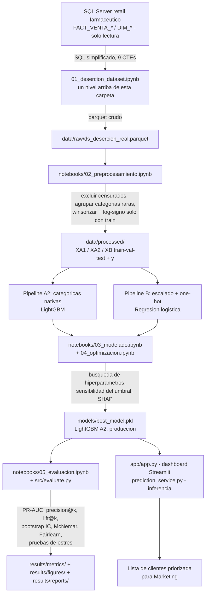

# Arquitectura y diseño del modelo

## Diagrama de flujo del sistema (input → output)

El pipeline de **recolección** (conexión a SQL Server y el SQL de 9 CTEs) vive
un nivel arriba de esta carpeta (`01_desercion_dataset.ipynb`), porque no forma
parte de exploración/preprocesamiento/modelado/optimización/evaluación — ver
`README_HANDOFF.md` para el detalle de esa decisión.

## Etiqueta

Umbral personalizado por cliente: percentil 90 de sus propios intervalos
entre compras (piso 14 días, techo 180 días), no una regla fija de 90 días.
Ventana de predicción: 120 días. Los clientes censurados (sin evento
observado dentro de la ventana) se **excluyen** del entrenamiento, no se les
recorta el umbral — recortarlo generaría falsos positivos sobre clientes
normales. Detalle completo y justificación (factor 7x entre segmentos,
censura 14,7% vs. 30% con ventanas más cortas) en `CONTEXTO_PROYECTO.md`
secciones 1-3.

## Partición

Por cliente **y** out-of-time: C1-C3 entrenamiento (796.044 filas), C4
validación (68.164 filas), C5 test (66.421 filas, tocado una sola vez). Un
mismo cliente puede aparecer en varios cortes; nunca se mezclan train/val/test
al azar entre cortes, porque eso equivaldría a entrenar con información del
futuro.

## Doble pipeline de preprocesamiento

- **Pipeline A (crudo, para árboles):**
  - **A1** — categóricas con one-hot + agrupación de raras en `OTROS` (18
    columnas).
  - **A2** — categóricas nativas de LightGBM, sin one-hot (14 columnas).
    **Es la que usa el modelo de producción.**
- **Pipeline B (para regresión logística):** winsorización (ajustada solo
  con train), log con signo, escalado y one-hot (18 columnas, imputación de
  nulos con la mediana de train). Necesita escala; los árboles no.

Transformadores (`src/preprocesamiento.py`: `AgrupadorRaras`,
`LimpiaInfinitos`, `Winsorizador`, `LogConSigno`) ajustados **solo con
train** — nunca con validación ni test.

## Escalera de modelos

| Nivel | Modelo | PR-AUC test | IC 95% (bootstrap) | Rol |
|---|---|---|---|---|
| 0 | Regla de recencia (`recency_dias`) | 0,6403 | [0,6343 – 0,6465] | Lo que la empresa hace hoy |
| 1 | RFM simple (z-score de recencia/visitas/gasto) | 0,6320 | — | Aproximación al script existente de producción |
| 2 | Regresión logística (pipeline B, L2, C=0,01) | 0,6701 | [0,6643 – 0,6761] | Interpretable y calibrada |
| **3** | **LightGBM A2 (categóricas nativas)** | **0,6875** | **[0,6819 – 0,6929]** | **Modelo de producción** |
| 4 | Análisis de supervivencia | — | — | Pendiente (T3.8) — diferenciador académico |

Los intervalos de confianza del nivel 3 no se solapan con los de los niveles 0
y 2, y la diferencia es significativa (McNemar, p < 0,0001 en ambos casos) —
ver `optimizacion.md` y `results/metrics/evaluacion_estadistica_robusta.json`
para el detalle completo de esta prueba, agregada el 17/10/2026.

## Por qué LightGBM A2 y no A1

Empate técnico en PR-AUC de validación (0,6975 en ambas variantes, diferencia
en la 4ª cifra decimal). Se elige A2 por simplicidad de pipeline: 14 columnas
en vez de 18, no requiere expandir one-hot si aparecen categorías nuevas de
método de pago. Decisión documentada por simplicidad, no por una diferencia
de desempeño — ver `optimizacion.md` para la búsqueda de hiperparámetros
completa.

## Diagnóstico de overfitting / underfitting

Se corrió un diagnóstico cuantitativo dedicado (tres regímenes controlados:
overfitting inducido, underfitting inducido, y óptimo = hiperparámetros de
producción) sobre LightGBM A2. **Veredicto: ÓPTIMO** — sin evidencia de
overfitting ni underfitting, con una brecha train/validación pequeña y
estable (`best_iteration=56`, PR-AUC val=0,6975). No se recomienda
re-tunear los hiperparámetros actuales. Reporte completo en
[`diagnostic_report_overfitting.pdf`](diagnostic_report_overfitting.pdf).

## Por qué no SMOTE, no target encoding, no dataset de telco

- **SMOTE descartado:** genera clientes sintéticos inexistentes, rompe la
  calibración de probabilidades y es engañoso con la estructura temporal del
  problema.
- **Target encoding descartado** en esta versión: riesgo de fuga no
  justificado frente a un aporte marginal (PDV).
- **Dataset público de telco (Kaggle) descartado** como espejo: es churn
  contractual, elimina exactamente el problema que se quiere resolver. Si
  hiciera falta un espejo público, la alternativa es **Online Retail II
  (UCI)** — retail no contractual, análogo al caso de estudio.

## Explicabilidad

`shap.TreeExplainer` sobre LightGBM A2. `recency_dias` domina la
importancia, seguido de `umbral_propio_dias` y `n_dias_activo_12m`. Hallazgo
declarado (no resuelto): `es_comprador_cronico` y `pct_gasto_cronico_12m` —
pensadas para distinguir fuga comercial de fin de tratamiento — tienen
importancia casi nula; el modelo no se apoya en ellas. Detalle y ejemplos
individuales en `notebooks/05_evaluacion.ipynb`.

## Validación adicional (pruebas de estrés)

El modelo de producción se sometió a pruebas de estrés simulando condiciones
fuera del laboratorio (ruido gaussiano creciente, datos faltantes, desbalance
extremo, corrimiento de distribución en `recency_dias`, caída de una feature
clave), sin reentrenar y sobre el conjunto de validación. Resultados y umbral
de degradación aceptable en `optimizacion.md` y
`results/metrics/pruebas_estres.json`.

## Tecnologías y librerías (con versiones)

| Categoría | Librería | Versión |
|---|---|---|
| Datos | pandas | 2.3.3 |
| Datos | numpy | 2.2.6 |
| Datos | pyarrow (lectura de parquet) | 25.0.1 |
| Modelado | scikit-learn | 1.7.2 |
| Modelado | lightgbm | 4.7.0 |
| Explicabilidad | shap | 0.49.1 |
| Serialización | joblib | 1.6.0 |
| Visualización | matplotlib | 3.10.9 |
| Notebooks | nbformat | 5.11.1 |
| Pruebas | pytest | 9.1.1 |
| Evaluación estadística / fairness | scipy | 1.15.3 |
| Evaluación estadística / fairness | fairlearn | 0.14.0 |
| Optimización de hiperparámetros | optuna | 5.0.0 |

Lista completa y comandos de instalación en `requirements.txt` (raíz del
proyecto). Python 3.10+.
